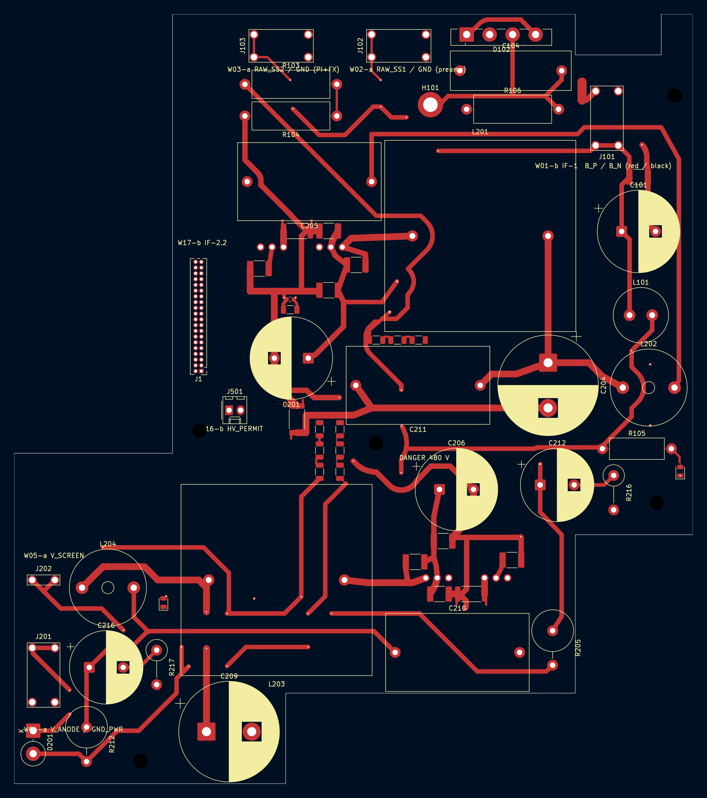
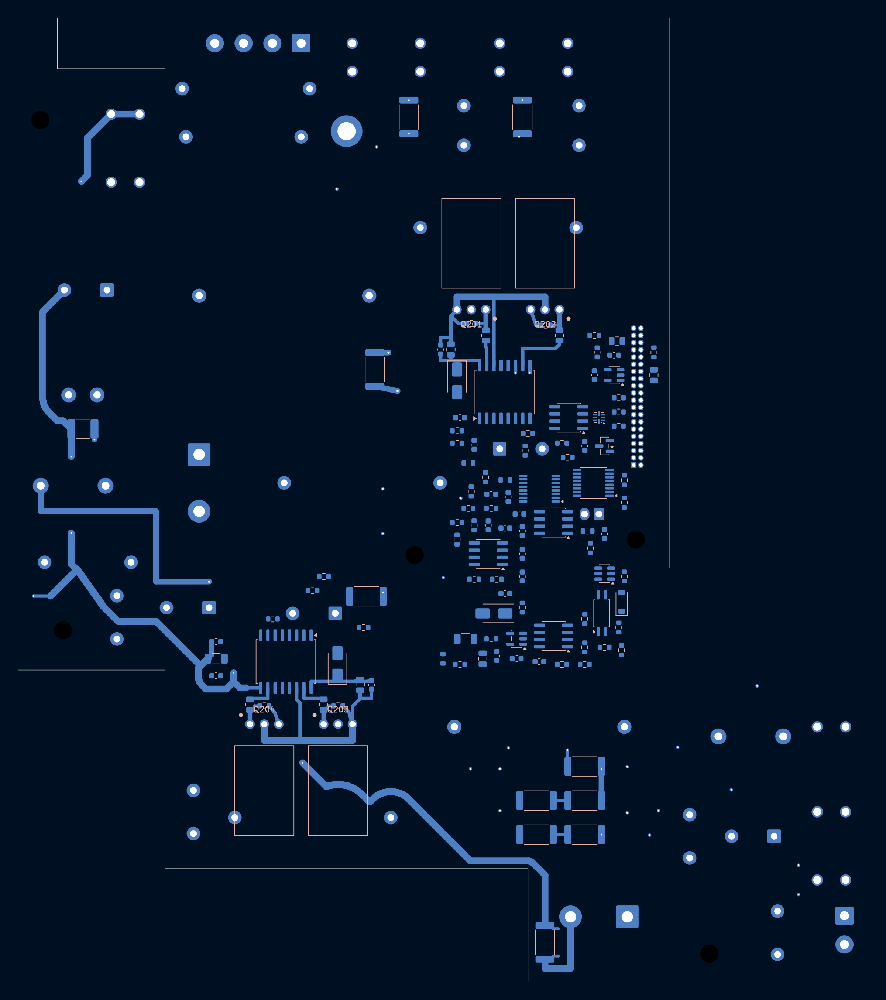
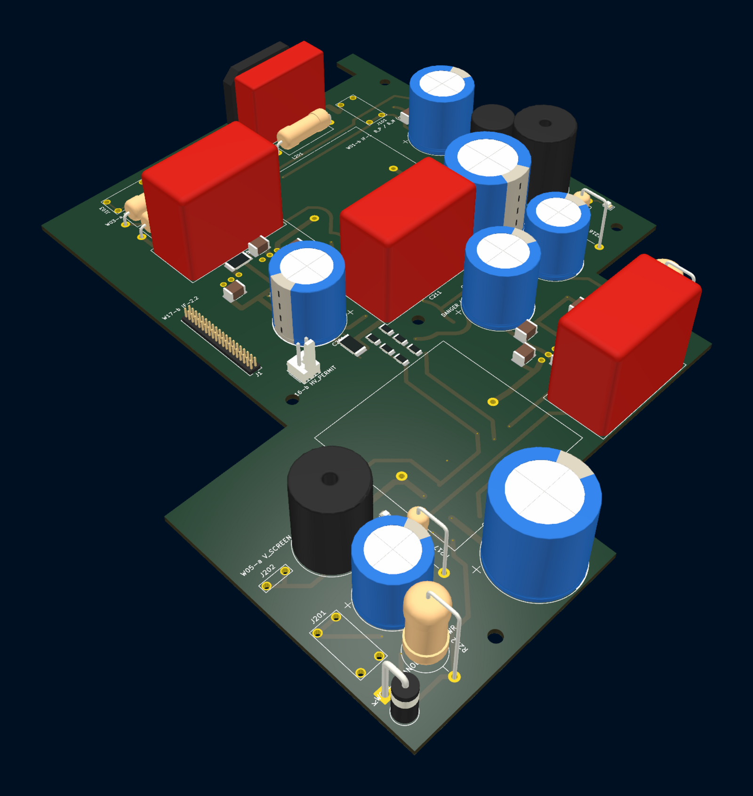

# Board renders

Rendered by CI from `johonkanen/tube_hv_supplies_kicad` commit [`8800a549f5`](https://github.com/johonkanen/tube_hv_supplies_kicad/commit/8800a549f57e48c5e9d9b19287351f63d6db6880) on 2026-11-25 06:08 UTC with 10.0.7.
This branch is force-pushed on every render; do not commit to it.

## tube_hv_supplies_rev3 (`rev3/kicad/tube_hv_supplies_rev3.kicad_pcb`)

Copper layers:
- [B_Cu](tube_hv_supplies_rev3/B_Cu.png)
- [F_Cu](tube_hv_supplies_rev3/F_Cu.png)
- [In1_Cu](tube_hv_supplies_rev3/In1_Cu.png)
- [In2_Cu](tube_hv_supplies_rev3/In2_Cu.png)
