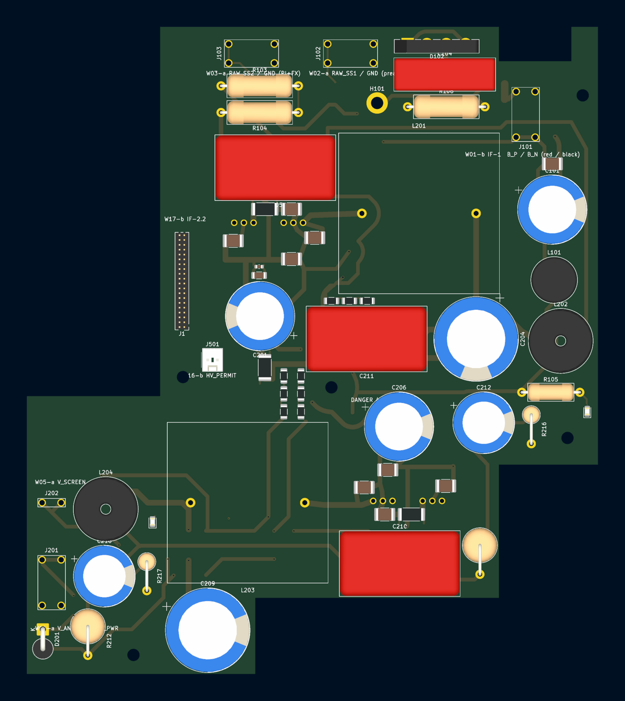
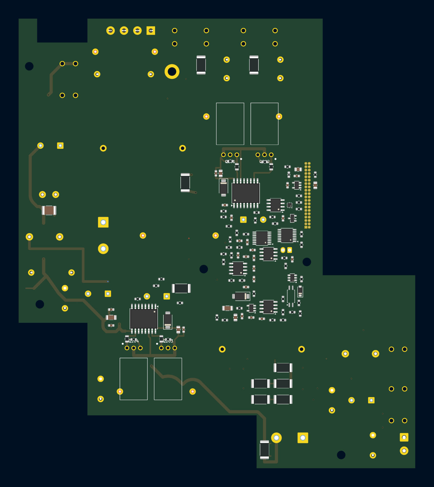

# tube_hv_supplies_kicad

KiCad 10 migration of the high-voltage supplies board (2x half-bridge converters that set the tube voltages for power scaling) of the tube amplifier, from Proteus. The schematic is redrawn from
the Proteus PDF and the PCB is rebuilt from the Gerber X2 export, so that every pad, track,
via and pour carries a net from the new schematic. The IPC-D-356A netlist of the CADCAM export
is the reference that every check compares against.

This is **rev A, the as-built baseline**. The redesign (ribbon cables, PCB-mount pots, the new
power section) starts from it. The amplifier project, its specification and the hardware state
are in [tube_amplifier_kicad](https://github.com/johonkanen/tube_amplifier_kicad), which includes
this repo as a submodule once the conversion is verified.

## Latest renders

Rendered by CI (`.github/workflows/renders.yml`) on every push to main that changes a `.kicad_pcb`. Every copper layer, an isometric 3D view and the commit the images were made from are on the [`renders` branch](https://github.com/johonkanen/tube_hv_supplies_kicad/tree/renders) (force-pushed by CI, never merged).





## Method

The shared [proteus2kicad](https://github.com/johonkanen/proteus2kicad) tools, a submodule in
`tools/p2k` (clone with `git clone --recurse-submodules`, or run `git submodule update --init`).
The phases and checks are in `tools/p2k/CONVERSION_PLAYBOOK.md`. Everything specific to this
board is in `p2k_config.py`.

## Status

Conversion plan: [PLAN.md](PLAN.md); progress: [STATUS.md](STATUS.md); prompt for the next agent session: [next_prompt.md](next_prompt.md).

**The conversion is complete (Phases 0-5, 2026-11-20).** Schematic redrawn on 6 sheets (158 parts,
netlist equal to the IPC, ERC 0 errors), footprints assigned (`lib/footprint_map.csv`,
`lib/tube_hv_supplies.pretty`; every part fits the IPC pads within 0.05 mm), PCB generated
(`tools/make_pcb.sh`: 4 layers, pours on all layers, 141 vias, board 1.6 mm, reference texts placed
by `p2k.place_refdes`; Proteus copper 0 shorts / 0 orphans / 0 opens). Pad sizes (user decisions):
the Proteus pads on U1 U2 ADC1-ADC3 DRV5 DRV6 J1 J2 and on the TO-220s Q3 Q4 Q7 Q8 (1.524 x 2.54 mm
rounded rectangles from the gerbers, drill 1.016: 1.016 mm between the HV pins), J1 and J2 all
round; KiCad pads elsewhere. DRC 0 errors apart from the accepted courtyard overlaps. Independent
verification: KiCad's IPC-D-356 export equals the Proteus netlist (574 records, 113 nets 1:1), and
KiCad's gerbers equal the Proteus gerbers on all four copper layers and in the drills outside the
pad shapes of the KiCad-pad parts. `tools/check_all.sh` printed ALL CHECKS PASSED (18 steps).
The board was generated until D-STOP (below); hand edits since then. Open, report-only: the design findings in STATUS.md.
After Phase 5 the bias rail `+2V5_BIAS` was renamed `+1V0_BIAS` in the KiCad design (user decision:
REF1 is the 1.5 V ISL21010 into a 220 / 470 divider, about 1.0 V); the Proteus files keep the old name
and `p2k_config.NET_ALIASES` maps it for every check.

**Design fixes 2026-11-20 (user decisions; component values unchanged; STATUS.md "Design fixes
2026-11-20"):** the current-measurement nets are renamed to what they measure, through `NET_ALIASES`:
`CURRENT_C3` / `CURRENT_C6` (the shunts R75 / R30 under the filter capacitors C3 / C6), `CURRENT_Q4` /
`CURRENT_Q7` (the low-side emitter shunts R72 / R29), and the amplified signals on the control-card ribbon
`CURRENT_Q4_MEAS` (Proteus J1-1), `CURRENT_Q7_MEAS` (J1-3), `CURRENT_C6_MEAS` (J1-5), `CURRENT_C3_MEAS` (J1-7)
(Proteus: `C1_CURRENT`, `C3_CURRENT`, `CURRENT_L1`, `CURRENT_L3`, `C2_CURRENT_MEAS`, `C3_CURRENT_MEAS`,
`INPUT_CURRENT_MEAS`, `C1_CURRENT_MEAS`). The dangling Proteus copper stubs are removed (finding 14).
`tools/check_all.sh` prints ALL CHECKS PASSED (19 steps). Still to come: the ADC VA / VIN fix (finding 6, a
hand edit after generation stops) and the J1 renumbering (finding 12; done 2026-11-20, below).

**Shared-tool migration 2026-11-20 (STATUS.md "Shared-tool migration 2026-11-20"):** `tools/p2k` bumped
to a9a286c; every board-local tool replaced by the shared proteus2kicad tools and config keys (`p2k erc`,
`p2k check_pin_order` + `PIN_ORDER`, `p2k.check_pads` + `PROTEUS_PADS_CHECK`, `REMOVED_TRACKS` with a count,
`p2k make_pcb`, `part_map.run`, the spec key `pads`, `FP_LIB_TABLE`); no strict-check opt-outs. The ribbon
header J1 now has the standard 2x20 numbering (`IPC_PIN_IDS`: Proteus pin k = KiCad pad k + 1 / k - 1, odd /
even; finding 12, together with the control card's J11, so the cable still joins pad k to pad k): copper
unchanged except the square pin-1 pad (user decision). The four current-measurement outputs are now J1-2 / 4
/ 6 / 8. `tools/check_all.sh` prints ALL CHECKS PASSED (18 steps). Still to come: the ADC VA / VIN fix
(finding 6, a hand edit after generation stops).

**HV supplies v2 is not installed and will be redone anyway: this conversion is only the starting point
for the redesign** (user, 2026-11-20).

**Generation stopped 2026-11-20 (user decision D-STOP; STATUS.md "Generation stopped 2026-11-20"):** the
board is no longer generated from the Proteus data. `kicad/` and `lib/` are edited by hand from now on; the
generators are kept as frozen history in `tools/generate/` (they refuse to run without
`--force-regenerate`). `tools/check_all.sh` no longer regenerates or byte-compares anything: it checks the
committed files against the Proteus sources (netlist, pads, vias, copper, drills) and the KiCad rules (ERC,
DRC) and prints ALL CHECKS PASSED (14 steps).

**Hand edit 1, finding 6 fixed (2026-11-20, user decision; STATUS.md "Hand edits after generation stopped"):**
ADC1-ADC3 (ADC121C027) now have 3V3 on VA (pin A1, SOT pad 1) and the filtered analog input on VIN (pin
COM2, pad 3), as in the TI pin table; Proteus had them swapped. Schematic: the symbol's VA / VIN pins
exchanged places (VA `power_in`); PCB: the copper at each part rerouted inside a small area, with two vias
per part, DRC unchanged. Component values unchanged. The checks that compare against Proteus run through
`tools/hand_edits.py`, which lists the deviations (6 pin nets, 3 areas, 6 vias) and accepts exactly those;
ALL CHECKS PASSED (14 steps).

v2, built 2026. v1 (built 2024, same outline and mounting holes) is not converted; add it as a tagged revision if it's ever needed.

## Source

`hi_voltage_suppliesv2.pdsprj` (Proteus 8.12). Exported 2026-11-19 from Proteus 8.12 SP2: schematic PDF, Gerber X2 CADCAM (metric)
with the IPC-D-356A netlist.

## Mechanical baseline

From the export (the fit reference for the redesign; the KiCad file is
`mechanical/hv_supplies_v2.kicad_pcb` in tube_amplifier_kicad):

```
outline: 170.08 x 56.48 mm, lower-left corner at (-122.600, -28.260) in the Proteus frame
copper layers: 4; components: 158; mounting holes: 4
mounting holes (relative to the lower-left outline corner, mm; numbered as the board refdes H1-H4):
  H1: x    4.490  y   51.755  drill 3.00 plated
  H2: x  165.490  y   51.755  drill 3.00 plated
  H3: x    4.490  y    4.755  drill 3.00 plated
  H4: x  165.490  y    4.755  drill 3.00 plated
```

(Corrected 2026-11-20: this list numbered the holes in another order than the board, old H2 / H3 / H4 =
board H3 / H4 / H2; the positions are unchanged.)

## Layout

```
source/         Proteus exports (read-only)
  cadcam/         Gerber X2 export with the IPC-D-356A netlist (the reference)
  schematic_pdf/  schematic PDF to redraw from
  *.pdsprj        Proteus project (schematic values, devices, packages, pin names)
reference/      tables derived from the IPC netlist (p2k ipc356; generated, don't edit)
lib/            part_map.csv, the project symbol and footprint libraries (generated until D-STOP, hand-edited since)
kicad/          KiCad project: root sheet + 6 sub-sheets (one per PDF page)
tools/p2k/       proteus2kicad (submodule)
tools/generate/ the frozen rev A generators (part map, symbols, sheets, footprints, make_pcb.sh): history, don't run
tools/hand_edits.py  the recorded deviations from Proteus since D-STOP; wrapper for the Proteus-based checks
reports/roundtrip/  round-trip report and overlays (KiCad gerbers vs Proteus)
tools/check_all.sh  every verification step (run at the start and end of a session)
p2k_config.py   board configuration for the shared tools (incl. PIN_ORDER, PROTEUS_PADS_CHECK, REMOVED_TRACKS)
```
